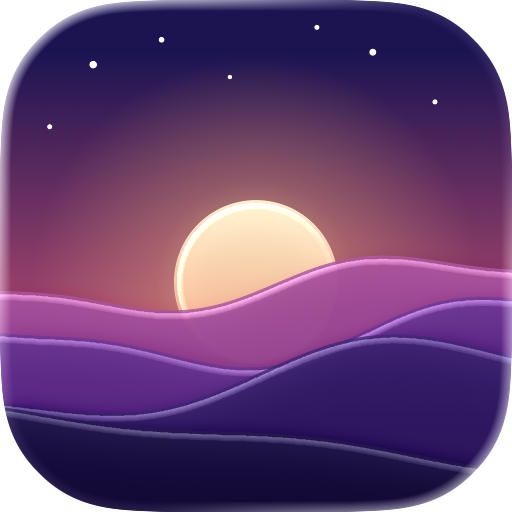
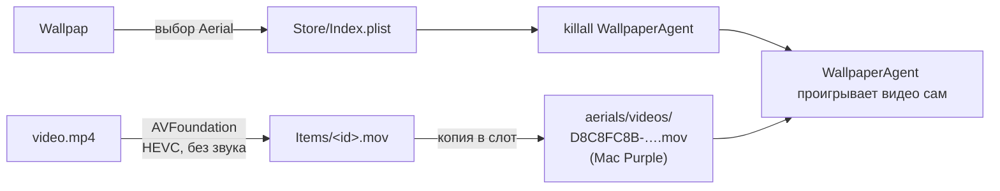

<p align="center">
  
</p>

<h1 align="center">Wallpap</h1>

<p align="center">
  Видео- и фото-обои для macOS 26 Tahoe — средствами самой системы.<br>
  Без фоновых процессов, без автозапуска, без расхода батареи на «живой» плеер.
</p>

<p align="center">
  <a href="https://github.com/undemorbe/wallpap/releases/latest/download/Wallpap.dmg"><b>⬇ Скачать Wallpap.dmg</b></a>
  &nbsp;·&nbsp;
  <a href="https://github.com/undemorbe/wallpap/releases">Все релизы</a>
</p>

<p align="center">
  <a href="https://github.com/undemorbe/wallpap/actions/workflows/ci.yml"></a>
  <a href="https://github.com/undemorbe/wallpap/releases/latest"></a>
  
  
  <a href="LICENSE"></a>
</p>

> **English summary.** Wallpap sets any video or image as your macOS 26 desktop wallpaper using the system's own
> Aerial player — nothing of ours keeps running in the background. Download `Wallpap.dmg` from
> [Releases](https://github.com/undemorbe/wallpap/releases/latest), drag it to Applications, and drop a video into the window.

---

## Содержание

- [Возможности](#возможности)
- [Требования](#требования)
- [Установка](#установка)
- [Использование](#использование)
- [Командная строка](#командная-строка)
- [Как это устроено](#как-это-устроено)
- [Где лежат файлы](#где-лежат-файлы)
- [Ограничения и известные проблемы](#ограничения-и-известные-проблемы)
- [Удаление](#удаление)
- [Каталог онлайн-обоев](#каталог-онлайн-обоев)
- [Иконка](#иконка)
- [Сборка из исходников](#сборка-из-исходников)
- [CI/CD и релизы](#cicd-и-релизы)
- [Структура проекта](#структура-проекта)
- [FAQ](#faq)
- [Лицензия](#лицензия)

## Возможности

- 🎬 **Видео-обои** из MP4, MOV, M4V — проигрываются самим `WallpaperAgent` macOS, как встроенные Aerial.
- 🖼 **Фото-обои** из HEIC, JPEG, PNG и любых других форматов, которые понимает macOS.
- 💤 **Ноль фоновых процессов.** После установки обоев Wallpap можно закрыть — фон останется и переживёт перезагрузку.
- 🔒 **Видео и на заставке** — выбор пишется и для рабочего стола, и для заставки (Idle).
- 📚 **Библиотека** с превью: перетаскивание файлов в окно, переименование, удаление, «Показать в Finder».
- 🌐 **Каталог онлайн-обоев** из 10 источников: Wallhaven, Openverse, NASA, Apple Aerials, Bing, Unsplash, Pexels, Pixabay и др. — см. [Каталог онлайн-обоев](#каталог-онлайн-обоев).
- 🎛 **Настройки воспроизведения**: анимация на рабочем столе и экране блокировки, пауза когда стол не виден,
  от аккумулятора или в режиме энергосбережения, скорость 0.25–2×, «заполнить» / «вписать».
- ⚙️ **Автоматическая конвертация** видео в HEVC `.mov` без звука — формат, который ожидает системный плеер.
- 💻 **CLI** для скриптов и автоматизации (Shortcuts, cron, Raycast/Alfred).
- 🛟 **Бэкап** оригинальной обложки слота и команда для полного отката.

## Требования

| | |
|---|---|
| **ОС** | macOS 26 Tahoe или новее |
| **Процессор** | Apple Silicon (M1 и новее). Intel-сборки нет |
| **Обои** | Хотя бы раз откройте «Системные настройки → Обои», чтобы macOS создала хранилище обоев |

## Установка

### Готовая сборка (рекомендуется)

1. Скачайте **[Wallpap.dmg](https://github.com/undemorbe/wallpap/releases/latest/download/Wallpap.dmg)** со страницы
   [последнего релиза](https://github.com/undemorbe/wallpap/releases/latest).
2. Откройте DMG и перетащите **Wallpap** в папку **Программы**.
3. Запустите Wallpap.

> [!IMPORTANT]
> Если релиз не нотаризован Apple (это указано в описании релиза), macOS при первом запуске сообщит,
> что не может проверить разработчика. Это ожидаемо для бесплатных open-source сборок. Варианты:
>
> - **Терминал** (один раз):
>   ```bash
>   xattr -dr com.apple.quarantine /Applications/Wallpap.app
>   ```
> - **Без Терминала:** попробуйте открыть приложение, затем «Системные настройки → Конфиденциальность и безопасность»
>   → внизу «Wallpap заблокировано…» → **«Всё равно открыть»**.

Есть также `Wallpap.zip` — та же сборка без DMG. Контрольные суммы — в `SHA256SUMS.txt` каждого релиза:

```bash
shasum -a 256 -c SHA256SUMS.txt
```

### Из исходников

См. раздел [Сборка из исходников](#сборка-из-исходников).

## Использование

1. **Добавьте файл** — перетащите видео или картинку в окно Wallpap либо нажмите **＋** на панели инструментов.
   Видео конвертируется в HEVC; прогресс виден внизу окна.
2. **Выберите карточку** и нажмите **«Установить как фон»** (или дважды кликните по карточке).
3. **Закройте приложение.** Обои продолжат работать — их проигрывает macOS.

Обои из интернета — в разделе [Каталог онлайн-обоев](#каталог-онлайн-обоев).
Соблюдайте лицензии и условия использования каждого сервиса.

### Меню

Меню **«Ещё»** (⋯) на панели инструментов:

- **Открыть «Обои» в Системных настройках** — быстро перейти к системным настройкам обоев.
- **Показать папку библиотеки** — открыть `~/Library/Application Support/Wallpap/Items` в Finder.
- **Убрать видео из системного слота** — удалить ваше видео и вернуть оригинальный Aerial Mac Purple.

Контекстное меню карточки (правый клик): установить, переименовать, показать в Finder, удалить.

> [!TIP]
> Для лучшего результата используйте видео в разрешении экрана (или выше), 24–60 fps, длиной 10–60 секунд,
> с бесшовной склейкой конца и начала — системный плеер проигрывает ролик по кругу.

## Командная строка

Тот же бинарник работает и как CLI (окно не открывается):

```bash
WALLPAP=/Applications/Wallpap.app/Contents/MacOS/Wallpap

# Импортировать файл в библиотеку
$WALLPAP --import ~/Downloads/video.mp4

# Импортировать и сразу поставить фоном
$WALLPAP --import ~/Downloads/video.mp4 --apply

# Поставить фоном элемент библиотеки по части названия (без учёта регистра)
$WALLPAP --apply hunt

# Убрать видео из системного слота и вернуть Mac Purple
$WALLPAP --reset-slot
```

| Код выхода | Значение |
|---|---|
| `0` | Успех |
| `1` | Ошибка (файл не найден, не удалось конвертировать, нет элемента в библиотеке и т. п.) |
| `64` | Неверные аргументы |

## Как это устроено



- **Видео.** macOS проигрывает обои Aerial (видео) сама, через `WallpaperAgent`. Скачанные Aerial лежат в
  `~/Library/Application Support/com.apple.wallpaper/aerials/videos/<ID>.mov`.
  Wallpap перекодирует ваше видео в HEVC `.mov` (через AVFoundation, звук убирается) и кладёт его
  на место встроенного Aerial **Mac Purple** (`D8C8FC8B-9D11-4803-944F-DF284B35FE58`), который служит «слотом».
  Обложка в «Системных настройках» тоже заменяется. Затем выбор записывается в хранилище обоев
  `Store/Index.plist` (рабочий стол и заставка), и `WallpaperAgent` перезапускается.
- **Изображения.** Выбор `com.apple.wallpaper.choice.image` записывается в тот же `Index.plist`.
- **Почему слот, а не свой пункт в каталоге Aerial?** Добавить свой пункт нельзя: macOS сверяет `manifest.tar`
  с сервером Apple и скачивает его заново. Поэтому используется существующий Aerial.
- **Расширение `WallpapWallpaper.appex`** (экспериментальное). Приложение также содержит расширение для точки
  `com.apple.wallpaper` (ExtensionKit), которое читает библиотеку Wallpap в песочнице и отдаёт видео системному
  агенту через приватный XPC-протокол `WallpaperExtensionKit`. Основной сценарий от него не зависит.

## Где лежат файлы

| Путь | Что там |
|---|---|
| `~/Library/Application Support/Wallpap/library.json` | Индекс библиотеки и активные обои |
| `~/Library/Application Support/Wallpap/Items/` | Сконвертированные видео, картинки и превью |
| `~/Library/Application Support/Wallpap/settings.json` | Настройки воспроизведения (читает расширение) |
| `~/Library/Application Support/Wallpap/slot-thumbnail-original.png` | Оригинальная обложка Mac Purple |
| `~/Library/Application Support/com.apple.wallpaper/Store/Index.plist` | Системное хранилище выбора обоев |
| `~/Library/Application Support/com.apple.wallpaper/aerials/videos/D8C8FC8B-….mov` | Слот с вашим видео |

## Ограничения и известные проблемы

- В «Системных настройках» видео отображается под названием **Mac Purple** — это и есть слот.
- Одновременно может стоять **одно** видео (слот один). Картинок — сколько угодно.
- Если в настройках удалить загрузку Mac Purple или выбрать другие обои, просто поставьте видео заново через Wallpap.
- Если Apple уберёт Mac Purple в будущем обновлении, поменяйте `slotAssetID` в
  [`SystemWallpaper.swift`](Sources/Wallpap/SystemWallpaper.swift) на ID другого Aerial.
- Используются недокументированные форматы и приватные API macOS — после крупных обновлений системы что-то может сломаться.
- Сборка только под Apple Silicon.

## Удаление

```bash
# 1. Вернуть системный Aerial и обложку
/Applications/Wallpap.app/Contents/MacOS/Wallpap --reset-slot

# 2. Удалить приложение и данные
rm -rf /Applications/Wallpap.app
rm -rf ~/Library/Application\ Support/Wallpap
```

После этого выберите любые другие обои в «Системных настройках → Обои».

## Каталог онлайн-обоев

Боковая панель → «Каталог». Источники (включаются в настройках, ⌘,):

| Источник | Что | Ключ |
| --- | --- | --- |
| Wallhaven | фото, просмотры, избранное, топ за период | не нужен |
| WallpapersCraft | фото 4K/5K, загрузки и рейтинг (читается со страниц сайта, пауза 1 с между запросами по robots.txt) | не нужен |
| Openverse | 800+ млн открытых CC-фото со всего интернета | не нужен |
| Wikimedia Commons | избранные снимки сообщества | не нужен |
| NASA | фото и видео (mp4) | не нужен |
| Apple Aerials | видео 4K из каталога macOS | не нужен |
| Bing | фото дня в 4K | не нужен |
| Unsplash | фото, лайки | бесплатный Access Key |
| Pexels | фото и видео | бесплатный ключ |
| Pixabay | видео до 4K, просмотры/загрузки/лайки | бесплатный ключ |

akspic.ru и zastavok.net не отвечают из сети разработки, 4kwallpapers.com закрыт проверкой Cloudflare, поэтому их нет.

Фильтры: тип (видео/фото), сортировка (просмотры, лайки, топ за период, новые, случайные), минимум просмотров,
разрешение (Full HD … 5K), ориентация, длина видео. Ключи хранятся в UserDefaults.

```bash
/Applications/Wallpap.app/Contents/MacOS/Wallpap --catalog wallhaven --sort top --min-views 100000
/Applications/Wallpap.app/Contents/MacOS/Wallpap --catalog all --kind video --query ocean
```

## Иконка

`swift scripts/make-icon.swift` собирает слоистую иконку `Resources/AppIcon.icon` (её можно открыть в Icon Composer),
компилирует её через `actool` в `Assets.car` + `AppIcon.icns`, а в `Resources/IconPreviews/` кладёт рендеры
вариантов Default, Dark, Clear (светлый и тёмный) и Tinted.

## Сборка из исходников

Нужно: macOS 26, **Xcode 26** (или Command Line Tools со Swift 6), Apple Silicon.

```bash
git clone https://github.com/undemorbe/wallpap.git
cd wallpap
./build.sh               # сборка + установка в /Applications/Wallpap.app
./build.sh --no-install  # только сборка в build/Wallpap.app
```

Упаковать в DMG и ZIP (результат — в `dist/`):

```bash
scripts/package.sh 1.0.0
```

**Подпись.** `build.sh` берёт первый сертификат «Apple Development» из связки ключей, иначе подписывает ad-hoc.
Другую идентичность можно задать явно:

```bash
WALLPAP_SIGN_IDENTITY="Developer ID Application: Name (TEAMID)" ./build.sh --no-install
```

**Версия** в `Info.plist` задаётся переменными (CI делает это из git-тега):

```bash
WALLPAP_VERSION=1.2.0 WALLPAP_BUILD=42 ./build.sh --no-install
```

**Иконка** генерируется кодом — см. раздел [Иконка](#иконка).

## CI/CD и релизы

Используется GitHub Actions на раннерах `macos-26` (Apple Silicon).

| Workflow | Когда | Что делает |
|---|---|---|
| [`ci.yml`](.github/workflows/ci.yml) | push в `main`, pull request | Собирает приложение, проверяет подпись и структуру бандла, упаковывает DMG/ZIP и прикладывает их к запуску как артефакт |
| [`release.yml`](.github/workflows/release.yml) | push тега `v*` или ручной запуск | Собирает версию из тега, (опционально) подписывает Developer ID и нотаризует, публикует GitHub Release с `Wallpap.dmg`, `Wallpap.zip`, `SHA256SUMS.txt` |

### Выпустить новую версию

```bash
git tag v1.0.0
git push origin v1.0.0
```

Через несколько минут на странице [Releases](https://github.com/undemorbe/wallpap/releases) появится релиз.
Теги с суффиксом (`v1.1.0-beta.1`) публикуются как pre-release. Ссылка
`releases/latest/download/Wallpap.dmg` всегда ведёт на последний стабильный релиз.

### Подпись и нотаризация (опционально)

Без настройки релизы подписываются ad-hoc, и пользователям нужно один раз снять карантин (см. [Установка](#установка)).
Чтобы macOS открывала приложение без предупреждений, нужен платный аккаунт Apple Developer и секреты репозитория
(*Settings → Secrets and variables → Actions*):

| Секрет | Значение |
|---|---|
| `MACOS_CERTIFICATE` | Сертификат **Developer ID Application** в `.p12`, закодированный в base64: `base64 -i cert.p12 \| pbcopy` |
| `MACOS_CERTIFICATE_PASSWORD` | Пароль от `.p12` |
| `APPLE_ID` | Apple ID для нотаризации |
| `APPLE_TEAM_ID` | Team ID (10 символов) |
| `APPLE_APP_PASSWORD` | [App-specific password](https://support.apple.com/102654) для этого Apple ID |

Если заданы только сертификат и пароль — сборка будет подписана, но не нотаризована.

## Структура проекта

```
.
├── Sources/Wallpap/          # Приложение (SwiftUI + CLI)
│   ├── main.swift            #   точка входа, режим командной строки
│   ├── Views.swift           #   интерфейс: сетка библиотеки, импорт, меню
│   ├── Library.swift         #   библиотека: импорт, хранение, применение
│   ├── Media.swift           #   конвертация видео в HEVC, превью
│   └── SystemWallpaper.swift #   работа с хранилищем обоев macOS и слотом Aerial
├── Extension/                # Экспериментальное wallpaper-расширение (.appex)
├── Resources/                # Info.plist и иконка приложения
├── scripts/
│   ├── make-icon.swift       #   генерация иконки (AppIcon.icon, Assets.car, .icns)
│   └── package.sh            #   упаковка в DMG/ZIP + SHA256
├── .github/workflows/        # CI и релизы
├── build.sh                  # сборка, подпись, установка
└── Package.swift
```

## FAQ

**Тратит ли Wallpap батарею?**
Нет, сам Wallpap после установки обоев не работает. Видео проигрывает системный `WallpaperAgent` — так же, как
встроенные обои Aerial.

**Почему видео без звука?**
Системный плеер обоев звук не воспроизводит, поэтому дорожка удаляется при конвертации — так файл меньше.

**Обои пропали после обновления macOS.**
Обновление могло заново скачать Mac Purple или сбросить выбор. Откройте Wallpap и установите видео ещё раз.

**Можно ли поставить разные видео на разные мониторы?**
Пока нет — слот один, видео одно на все экраны.

**macOS пишет «приложение повреждено и не может быть открыто».**
Это карантин Gatekeeper для ненотаризованной сборки. Выполните
`xattr -dr com.apple.quarantine /Applications/Wallpap.app`.

## Лицензия

[MIT](LICENSE) © 2026 Boris Stankov

Wallpap не связан с Apple Inc. macOS, Aerial и Apple Silicon — товарные знаки Apple Inc.
